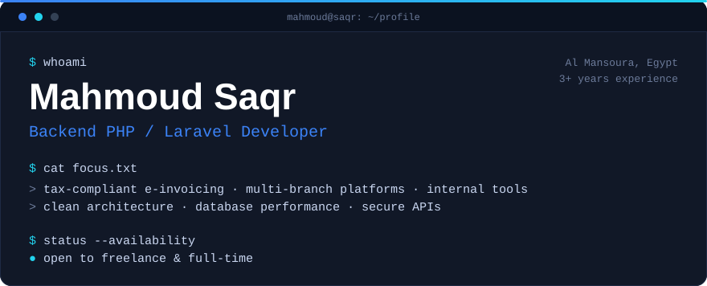

<!--
  Profile README for github.com/mahmoudlsaqr
  Setup: save this file as README.md and assets/hero.svg in a PUBLIC repository
  named exactly like the username: mahmoudlsaqr/mahmoudlsaqr.
  Every external image URL (stats widgets) is defined once, at the bottom of
  this file, so a service can be swapped or self-hosted in one place.
-->

<p align="center">
  
</p>

<p align="center">
  <a href="https://www.linkedin.com/in/mahmoud-saqr-9b557038a">LinkedIn</a> &nbsp;·&nbsp;
  <a href="mailto:m.sqr.info@gmail.com">m.sqr.info@gmail.com</a> &nbsp;·&nbsp;
  <a href="https://www.facebook.com/mahmoudlsaqr">Facebook</a>
</p>

<p align="center">
  
</p>

## About

I build backend systems that solve real business problems: tax-compliant e-invoicing, multi-branch platforms, and internal tools that hold up under real-world production workloads.

My focus is scalable Laravel applications, clean architecture, database optimization, API development, and maintainable software engineering.

I use AI-assisted development to speed up implementation, explore solutions, and improve productivity, while keeping engineering judgment, code quality, and architectural ownership in my hands.

| | |
|---|---|
| **Role** | Backend PHP / Laravel Developer |
| **Experience** | 3+ years |
| **Location** | Al Mansoura, Egypt |
| **Availability** | Open to freelance and full-time opportunities |

## Engineering highlights

- **ZATCA e-invoicing in production.** Implemented Phase 1 and Phase 2 integration.
- **About 40% faster.** Performance gain from SQL query optimization, Redis caching, and queue tuning.
- **Clinics Management Platform.** Built and maintain a multi-branch system used in production.
- **Administrative Communication System.** Designed an enterprise-level internal system used across departments.
- **Business-first backends.** Reliability, maintainability, and security come before feature count.

## Tech stack

| | |
|---|---|
| **Backend** | <br>PHP 8+ · Laravel |
| **API development** | RESTful APIs · Authentication · OAuth2 |
| **Frontend** | <br>JavaScript ES6+ · jQuery · AJAX · Bootstrap |
| **Database** | <br>MySQL · Redis |
| **Architecture** | SOLID · Clean Architecture · MVC · Design Patterns |
| **Security** | Input validation · Rate limiting · SSL · API security |
| **Tools** | <br>Git · GitHub · Composer · Docker · OpenSSL |
| **AI-assisted development** | AI coding agents · Prompt engineering · Vibe coding |

## Featured projects

<table>
  <tr>
    <td width="50%" valign="top">
      <h3><a href="https://github.com/mahmoudlsaqr/zatca-invoicing">ZATCA E-Invoicing Integration</a></h3>
      <p>E-invoicing engine compliant with Saudi ZATCA Phase 1 and Phase 2, running in production.</p>
      <p><sub><code>Laravel</code> <code>PHP</code> <code>OpenSSL</code> <code>MySQL</code></sub></p>
    </td>
    <td width="50%" valign="top">
      <h3><a href="https://github.com/mahmoudlsaqr/clinics-management">Clinics Management Platform</a></h3>
      <p>Multi-clinic scheduling and patient records management, running in production across branches.</p>
      <p><sub><code>Laravel</code> <code>MySQL</code> <code>Bootstrap</code></sub></p>
    </td>
  </tr>
  <tr>
    <td width="50%" valign="top">
      <h3><a href="https://github.com/mahmoudlsaqr/admin-communication">Administrative Communication System</a></h3>
      <p>Enterprise-level internal communication and workflow management used across departments.</p>
      <p><sub><code>Laravel</code> <code>AJAX</code></sub></p>
    </td>
    <td width="50%" valign="top">
      <h3><a href="https://github.com/mahmoudlsaqr/dental-lab-management">Dental Lab Management System</a></h3>
      <p>In development: order tracking and workflow management for dental laboratories.</p>
      <p><sub><code>Laravel</code> <code>MySQL</code> <code>Bootstrap</code> <code>AJAX</code></sub></p>
    </td>
  </tr>
</table>

## Engineering philosophy

```php
<?php

final class HowIWork
{
    // Code explains HOW. Comments explain WHY.
    public const READABILITY = 'Write code that shows its intent';

    public const PERFORMANCE = 'Measure before optimizing';

    public const SECURITY = 'A default, not a feature';

    public const LONGEVITY = 'Build for maintainability, not just for today';

    public const COMPLEXITY = 'Prefer simple and reliable over clever';

    public const AI = 'Accelerates the work. Judgment stays human-owned';
}
```

## Vibe coding, with engineering attached

> AI helps me move faster. Engineering principles help me move in the right direction.

I use AI as a collaborator inside a disciplined workflow, not as an autopilot. Nothing it produces ships until I understand it and can defend it.

| Stage | How AI helps | What I own |
|---|---|---|
| Implementation | Drafts and iterates on code | Structure, naming, and the final shape |
| Debugging | Suggests hypotheses faster | Reproducing the bug and proving the fix |
| Architecture | Challenges and compares options | The decision and its trade-offs |
| Review | Gives a second pair of eyes | Reading every change before it merges |

## GitHub activity

<div align="center">

[![GitHub streak][streak]](https://github.com/mahmoudlsaqr)

| | |

</div>

<sub>Language figures reflect only the public code on GitHub, not overall experience.</sub>

## Contact

I'm available for freelance projects and full-time roles, especially Laravel backends, API development, and systems that need to be reliable in production. The fastest way to reach me is email.

| | |
|---|---|
| **Email** | [m.sqr.info@gmail.com](mailto:m.sqr.info@gmail.com) |
| **LinkedIn** | [mahmoud-saqr-9b557038a](https://www.linkedin.com/in/mahmoud-saqr-9b557038a) |
| **GitHub** | [mahmoudlsaqr](https://github.com/mahmoudlsaqr) |
| **Facebook** | [mahmoudlsaqr](https://www.facebook.com/mahmoudlsaqr) |

<!-- External image endpoints. Change colors or host here, nowhere else.
     Palette: bg 0B1220, border 1F2A44, text C9D6F0, muted 6B7A99, blue 3B82F6, cyan 22D3EE.
     For reliability you can self-host both services (each project documents how). -->

[streak]: https://streak-stats.demolab.com/?user=mahmoudlsaqr&background=0B1220&border=1F2A44&stroke=1F2A44&ring=22D3EE&fire=3B82F6&currStreakNum=FFFFFF&sideNums=FFFFFF&currStreakLabel=22D3EE&sideLabels=C9D6F0&dates=6B7A99
[stats]: https://github-readme-stats.vercel.app/api?username=mahmoudlsaqr&show_icons=true&hide_border=true&bg_color=0B1220&title_color=22D3EE&text_color=C9D6F0&icon_color=3B82F6&custom_title=GitHub+Stats
[langs]: https://github-readme-stats.vercel.app/api/top-langs/?username=mahmoudlsaqr&layout=compact&langs_count=6&hide_border=true&bg_color=0B1220&title_color=22D3EE&text_color=C9D6F0&custom_title=Top+Languages
